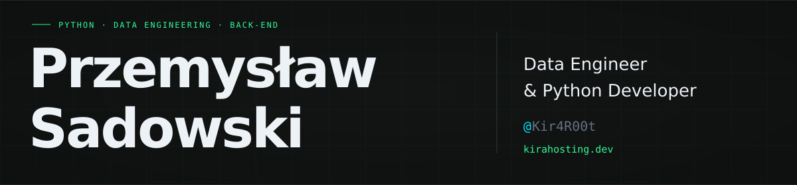

  

  <a href="https://discord.com/users/419571860041105410" title="Discord">
    <picture>
      <source media="(prefers-color-scheme: dark)" srcset="https://api.iconify.design/simple-icons/discord.svg?color=%2330FA98" />
      
    </picture>
  </a>
  &nbsp;&nbsp;
  <a href="https://github.com/Kir4R00t" title="GitHub">
    <picture>
      <source media="(prefers-color-scheme: dark)" srcset="https://api.iconify.design/simple-icons/github.svg?color=%2330FA98" />
      
    </picture>
  </a>
  &nbsp;&nbsp;
  <a href="https://www.linkedin.com/in/przemys%C5%82aw-sadowski-39266b297/" title="LinkedIn">
    <picture>
      <source media="(prefers-color-scheme: dark)" srcset="https://api.iconify.design/devicon-plain/linkedin.svg?color=%2330FA98" />
      
    </picture>
  </a>
  &nbsp;&nbsp;
  <a href="https://kirahosting.dev/" title="Website">
    <picture>
      <source media="(prefers-color-scheme: dark)" srcset="https://api.iconify.design/lucide/globe.svg?color=%2330FA98" />
      
    </picture>
  </a>

I'm a **Data Engineer & Python Developer** working with **Python, SQL, data pipelines and system integrations**. My experience includes Apache NiFi ingestion flows, backend services and automation connecting APIs, databases and ERP systems.

I'm also studying **Computer Science**. I like building tools I actually use, automating repetitive work and running my own services.

## Tech stack

### Python & data

  <picture>
    <source media="(prefers-color-scheme: dark)" srcset="https://api.iconify.design/simple-icons/python.svg?color=%2330FA98" />
    
  </picture>
  &nbsp;
  <picture>
    <source media="(prefers-color-scheme: dark)" srcset="https://api.iconify.design/simple-icons/postgresql.svg?color=%2330FA98" />
    
  </picture>
  &nbsp;
  <picture>
    <source media="(prefers-color-scheme: dark)" srcset="https://api.iconify.design/simple-icons/apachekafka.svg?color=%2330FA98" />
    
  </picture>
  &nbsp;
  <picture>
    <source media="(prefers-color-scheme: dark)" srcset="https://api.iconify.design/simple-icons/apachenifi.svg?color=%2330FA98" />
    
  </picture>
  &nbsp;
  <picture>
    <source media="(prefers-color-scheme: dark)" srcset="https://api.iconify.design/carbon/json.svg?color=%2330FA98" />
    
  </picture>
  &nbsp;
  <picture>
    <source media="(prefers-color-scheme: dark)" srcset="https://api.iconify.design/gis/geojson-file.svg?color=%2330FA98" />
    
  </picture>
  &nbsp;
  <picture>
    <source media="(prefers-color-scheme: dark)" srcset="https://api.iconify.design/mdi/api.svg?color=%2330FA98" />
    
  </picture>

JOLT for JSON transformations.

### Infrastructure & hosting

  <picture>
    <source media="(prefers-color-scheme: dark)" srcset="https://api.iconify.design/simple-icons/linux.svg?color=%2330FA98" />
    
  </picture>
  &nbsp;
  <picture>
    <source media="(prefers-color-scheme: dark)" srcset="https://api.iconify.design/simple-icons/redhat.svg?color=%2330FA98" />
    
  </picture>
  &nbsp;
  <picture>
    <source media="(prefers-color-scheme: dark)" srcset="https://api.iconify.design/simple-icons/docker.svg?color=%2330FA98" />
    
  </picture>
  &nbsp;
  <picture>
    <source media="(prefers-color-scheme: dark)" srcset="https://api.iconify.design/simple-icons/git.svg?color=%2330FA98" />
    
  </picture>
  &nbsp;
  <picture>
    <source media="(prefers-color-scheme: dark)" srcset="https://api.iconify.design/devicon-plain/azuredevops.svg?color=%2330FA98" />
    
  </picture>
  &nbsp;
  <picture>
    <source media="(prefers-color-scheme: dark)" srcset="https://api.iconify.design/simple-icons/cloudflare.svg?color=%2330FA98" />
    
  </picture>
  &nbsp;

VPS setup & administration · Cloudflare R2 object storage

Azure DevOps · Boards / Repos / PRs / CI/CD

### Other tools (less used)

  <picture>
    <source media="(prefers-color-scheme: dark)" srcset="https://api.iconify.design/devicon-plain/java.svg?color=%2330FA98" />
    
  </picture>
  &nbsp;
  <picture>
    <source media="(prefers-color-scheme: dark)" srcset="https://api.iconify.design/simple-icons/springboot.svg?color=%2330FA98" />
    
  </picture>
  &nbsp;
  <picture>
    <source media="(prefers-color-scheme: dark)" srcset="https://api.iconify.design/simple-icons/qt.svg?color=%2330FA98" />
    
  </picture>
  &nbsp;
  <picture>
    <source media="(prefers-color-scheme: dark)" srcset="https://api.iconify.design/simple-icons/odoo.svg?color=%2330FA98" />
    
  </picture>
  

## Professional experience

**Junior Software Engineer · PGZ OBR CTM S.A.** 
July 2024 – May 2026 · Gdynia, Poland

- **Data pipelines:** built Apache NiFi ingestion flows with Python and JOLT to transform JSON and GeoJSON data; worked with MinIO, Kafka and OpenSearch in a data platform.
- **Python & backend:** developed and maintained Python and Java / Spring Boot services, integrating external systems through REST APIs.
- **Odoo development:** built custom modules for Odoo 14 and 18 Community, wrote migration scripts and connected Odoo to external APIs and SQL Server to automate warehouse, project and timesheet data synchronization.
- **Team & delivery:** worked in a Scrum team using Linux / RHEL, Docker, Kubernetes, Git and Azure DevOps.

## Personal projects & exploration

  <picture>
    <source media="(prefers-color-scheme: dark)" srcset="https://api.iconify.design/simple-icons/selenium.svg?color=%2330FA98" />
    
  </picture>
  &nbsp;
  <picture>
    <source media="(prefers-color-scheme: dark)" srcset="https://api.iconify.design/simple-icons/django.svg?color=%2330FA98" />
    
  </picture>
  &nbsp;
  <picture>
    <source media="(prefers-color-scheme: dark)" srcset="https://api.iconify.design/simple-icons/raspberrypi.svg?color=%2330FA98" />
    
  </picture>
  &nbsp;
  <picture>
    <source media="(prefers-color-scheme: dark)" srcset="https://api.iconify.design/simple-icons/archlinux.svg?color=%2330FA98" />
    
  </picture>
  &nbsp;
  <picture>
    <source media="(prefers-color-scheme: dark)" srcset="https://api.iconify.design/simple-icons/mysql.svg?color=%2330FA98" />
    
  </picture>
  &nbsp;
  <picture>
    <source media="(prefers-color-scheme: dark)" srcset="https://api.iconify.design/simple-icons/cplusplus.svg?color=%2330FA98" />
    
  </picture>
  &nbsp;
  <picture>
    <source media="(prefers-color-scheme: dark)" srcset="https://api.iconify.design/simple-icons/html5.svg?color=%2330FA98" />
    
  </picture>
  &nbsp;
  <picture>
    <source media="(prefers-color-scheme: dark)" srcset="https://api.iconify.design/simple-icons/php.svg?color=%2330FA98" />
    
  </picture>
  &nbsp;
  <picture>
    <source media="(prefers-color-scheme: dark)" srcset="https://api.iconify.design/simple-icons/opensearch.svg?color=%2330FA98" />
    
  </picture>
  &nbsp;
  <picture>
    <source media="(prefers-color-scheme: dark)" srcset="https://api.iconify.design/devicon-plain/microsoftsqlserver.svg?color=%2330FA98" />
    
  </picture>
  &nbsp;
  <picture>
    <source media="(prefers-color-scheme: dark)" srcset="https://api.iconify.design/simple-icons/kubernetes.svg?color=%2330FA98" />
    
  </picture>
  &nbsp;

This is the stuff that I either explored myself or done some work for university or my job.